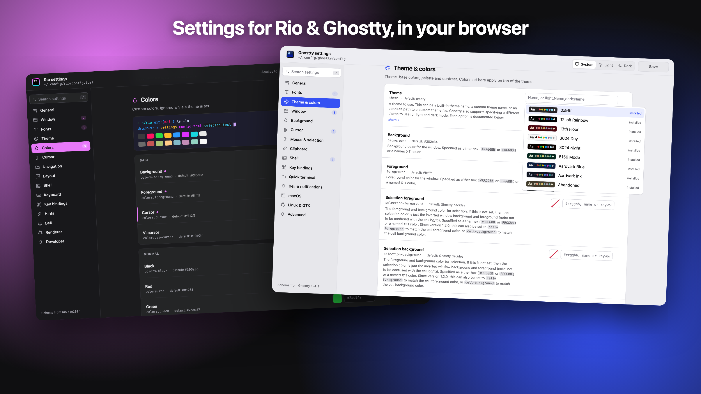
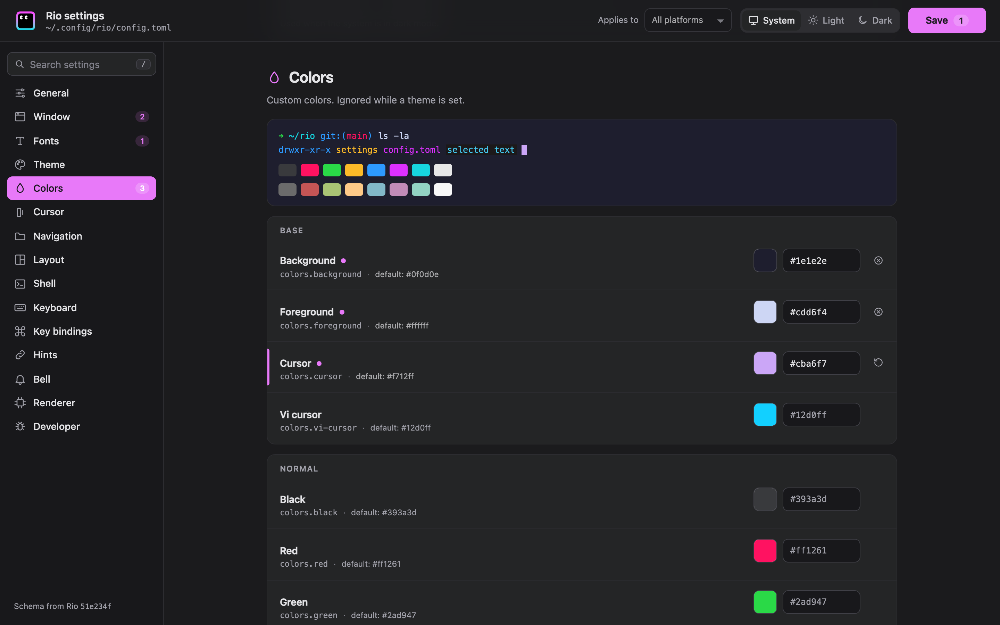
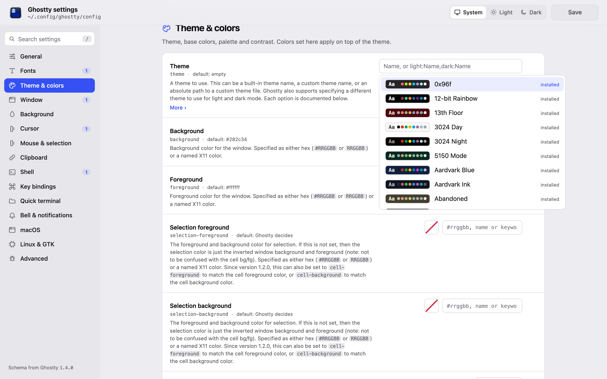
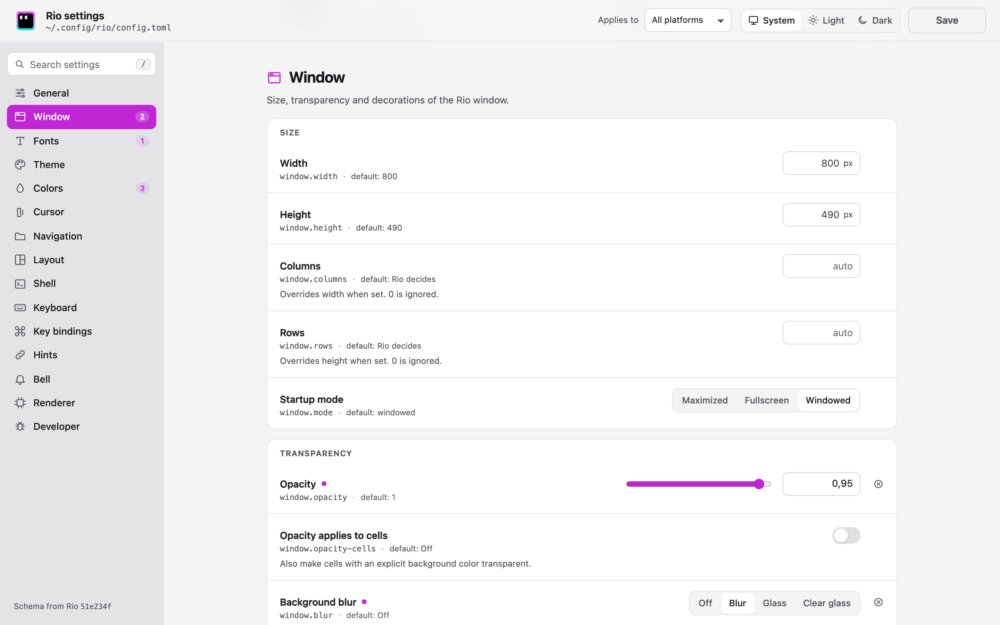
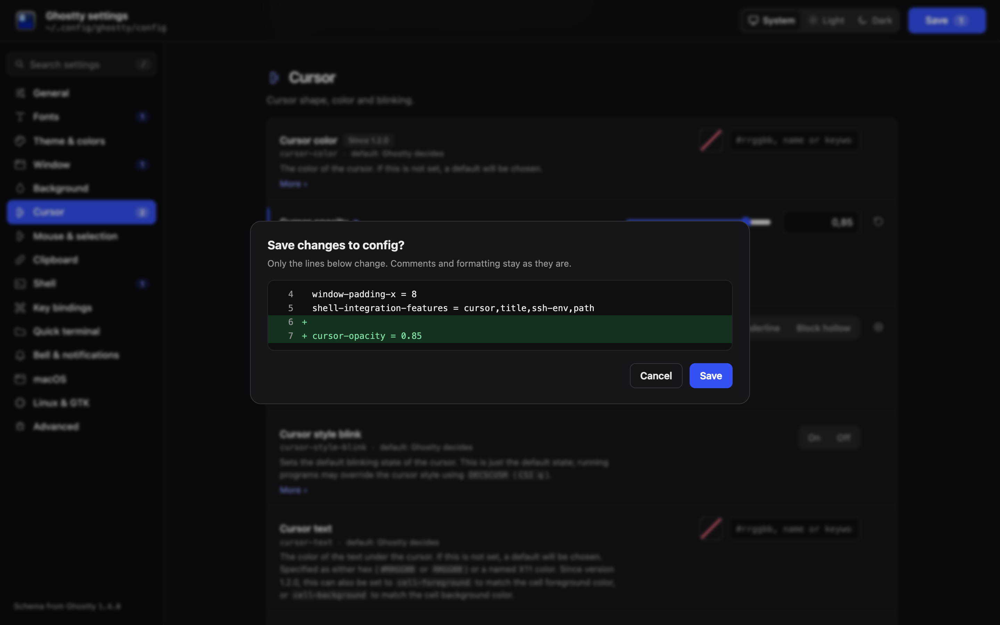

# terminal-settings

**A real settings window for terminals that only have a config file.**
Open it, change things, save. Your terminal picks the changes up. No more hunting through
config docs or editing TOML by hand.



There are two separate apps, one per terminal:

| | For | Runs on |
|---|---|---|
| **rio-settings** | [Rio](https://rioterm.com) | macOS, Linux, Windows |
| **ghostty-settings** | [Ghostty](https://ghostty.org) | macOS, Linux (Ghostty has no Windows version) |

Each one is a single small program. There's nothing to install, and no runtime or browser
extension is needed. It opens a settings page in your normal browser and saves straight to the
config file your terminal already reads.

## What you get

- **Every setting, explained.** All options the terminal supports, grouped into sections, with
  the terminal's own documentation, the default value, and badges like *macOS only* or
  *Restart needed*.
- **Proper controls.** Switches, sliders, color pickers with live swatches, a font picker that
  previews each font, a theme picker with color previews, key-binding and palette editors, and
  file pickers for images and shaders.
- **Your file stays yours.** Saving only changes the lines you edited. Comments, ordering and
  formatting are kept, and you see an exact diff before anything is written. A backup
  (`config.toml.bak`) is kept next to the file.
- **Changes apply right away.** Rio reloads by itself. With Ghostty, the editor asks it to
  reload (on macOS; on Linux, press <kbd>Ctrl</kbd><kbd>Shift</kbd><kbd>,</kbd> in Ghostty).
- **Searchable.** Press <kbd>/</kbd> and type, e.g. `opacity` or `font`.
- **Light and dark.** Follows your system, or pick one. Each editor wears its terminal's own
  colors and logo.
- **Safe to run.** The page is only reachable from your own computer, guarded by a one-time
  key. Nothing is sent anywhere. The only network use is downloading a Rio theme you choose.

| Rio, dark | Ghostty, light |
|---|---|
|  |  |
| **Rio, light** | **Ghostty, dark: the save preview** |
|  |  |

## Install

Download the file for your computer from the
[latest release](https://github.com/niklasfp/terminal-settings/releases). Releases are per app,
e.g. `rio-settings/v1.0.0`.

| Your computer | File |
|---|---|
| Mac with Apple silicon | `…-osx-arm64` |
| Linux, Intel/AMD | `…-linux-x64` |
| Linux, ARM | `…-linux-arm64` |
| Windows, Intel/AMD (Rio only) | `rio-settings-…-win-x64.exe` |
| Windows on ARM (Rio only) | `rio-settings-…-win-arm64.exe` |

Each release also has `.tar.gz` / `.zip` archives and a `SHA256SUMS` file if you want to verify
the download.

**First run on macOS:** the apps aren't signed by Apple, so macOS will block them the first
time. Allow it once from the terminal:

```sh
chmod +x rio-settings-*-osx-arm64
xattr -d com.apple.quarantine rio-settings-*-osx-arm64
```

**Linux:** `chmod +x` the file. **Windows:** if SmartScreen warns you, choose *More info →
Run anyway*.

Optionally move it somewhere on your `PATH`, e.g. `~/.local/bin/rio-settings`.

## Use

Run the app from a terminal:

```sh
rio-settings        # or: ghostty-settings
```

Your browser opens on the settings page. Change what you like, then press **Save** (or
<kbd>⌘</kbd>/<kbd>Ctrl</kbd>+<kbd>S</kbd>). Check the preview and confirm. Close the tab when
you're done; the app quits a few minutes later on its own.

Handy bits:
- The **↺** button next to a changed setting undoes your edit. On a setting saved in the file,
  **⊗** removes it again so the terminal's default applies.
- **Applies to** (Rio) lets you save a setting for one operating system only.
- Picking a Rio theme you don't have yet downloads it into Rio's `themes` folder.

### Options

| Option | What it does |
|---|---|
| `-c`, `--config <path>` | Edit a different config file |
| `-p`, `--port <n>` | Use a fixed port instead of a random free one |
| `--no-open` | Don't open the browser; just print the address |
| `--stay` | Keep running after the browser tab is closed |
| `-v`, `--version` | Print the version |
| `-h`, `--help` | Show help, including the config file it will edit |

### Which file gets edited

**Rio** reads `config.toml` from:

| OS | Location |
|---|---|
| macOS | `~/.config/rio/config.toml` |
| Linux | `$XDG_CONFIG_HOME/rio/config.toml`, usually `~/.config/rio/config.toml` |
| Windows | `%USERPROFILE%\AppData\Local\rio\config.toml` |

If `RIO_CONFIG_HOME` is set, Rio (and the editor) use that folder instead.

**Ghostty** reads `$XDG_CONFIG_HOME/ghostty/config.ghostty` (usually
`~/.config/ghostty/config.ghostty`), or `config` without the extension in older setups. The
editor edits whichever of the two exists. On macOS Ghostty also reads
`~/Library/Application Support/com.mitchellh.ghostty/config`, which is loaded later and wins.
The editor doesn't touch that file.

## Troubleshooting

- **"This page belongs to an earlier run of the editor"**: the app was restarted. Use the
  new address it printed, or just run it again.
- **Ghostty didn't reload after saving (macOS)**: the first time, macOS asks whether the editor
  may control Ghostty. If you said no, allow it in *System Settings → Privacy & Security →
  Automation*, or press <kbd>⌘</kbd><kbd>⇧</kbd><kbd>,</kbd> in Ghostty.
- **A change doesn't show up**: some settings only apply to new windows or after a restart.
  They're marked with a badge.
- **Font list is empty on Linux**: install `fontconfig` (it provides `fc-list`).
- **"Choose…" does nothing on Linux**: install `zenity` or `kdialog`.

## Building from source and contributing

See [editor/README.md](editor/README.md): how it's built, how the settings pages are generated
from each terminal's own source, and how to follow new terminal releases.

## License

[MIT](LICENSE).

## Credits

Rio and Ghostty are their respective projects' work. Their logos, palettes and theme data are
used to make each editor feel at home; see [THIRD-PARTY-NOTICES.md](THIRD-PARTY-NOTICES.md).
This project isn't affiliated with either.
