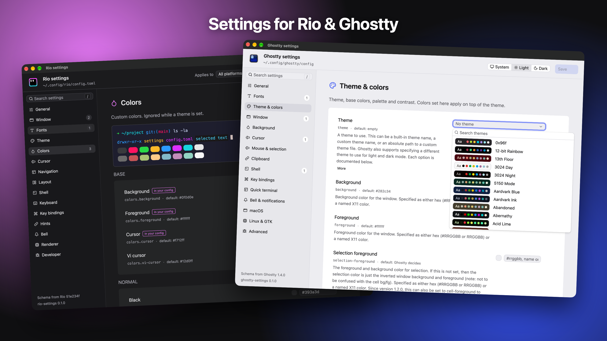
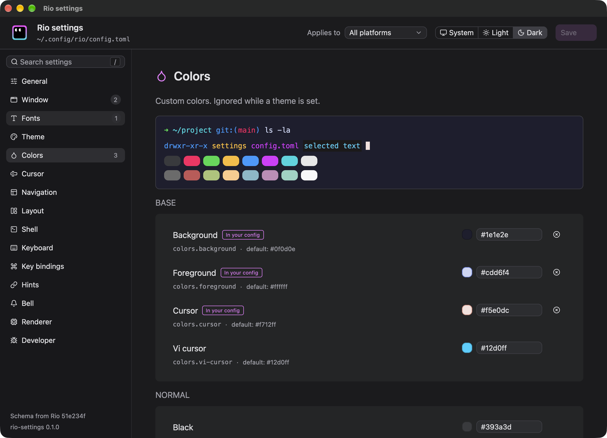
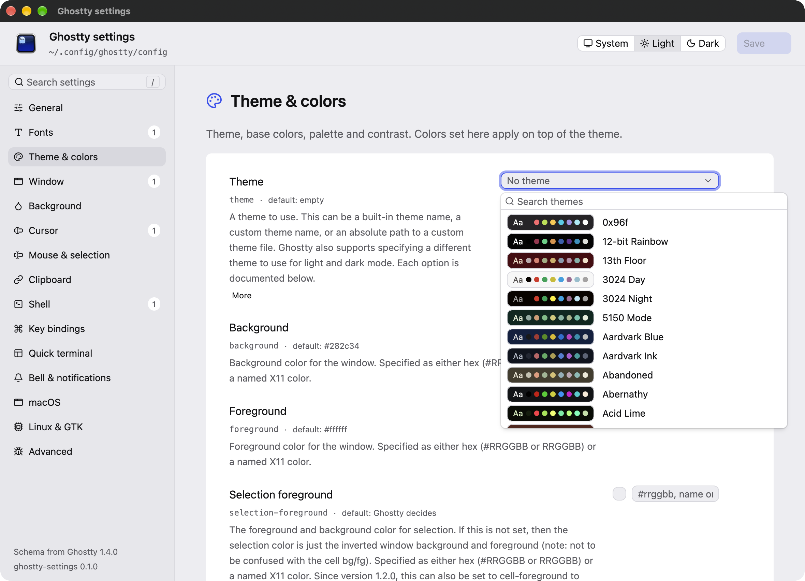
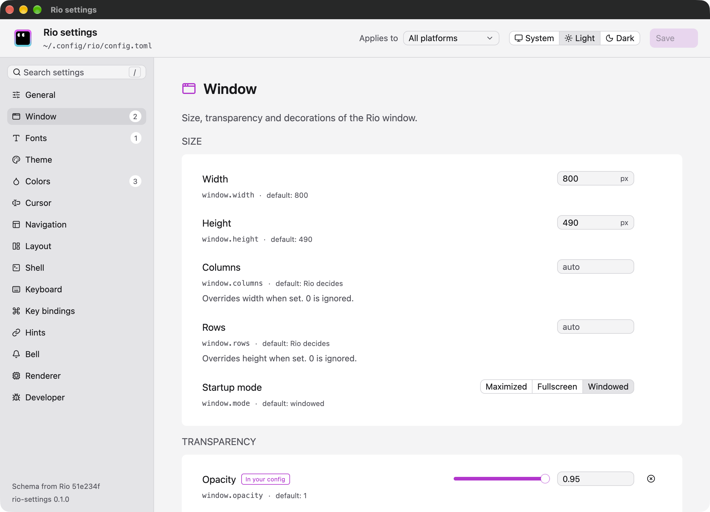
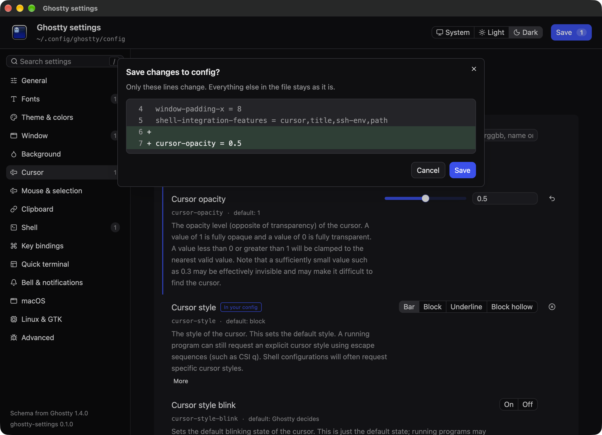

# terminal-settings

**A real settings window for terminals that only have a config file.**
Open it, change things, save. Your terminal picks the changes up. No more hunting through
config docs or editing config files by hand.



There are two separate native desktop apps, one per terminal:

| | For | Runs on |
|---|---|---|
| **rio-settings** | [Rio](https://rioterm.com) | macOS, Linux, Windows |
| **ghostty-settings** | [Ghostty](https://ghostty.org) | macOS, Linux (Ghostty has no Windows version) |

Each one is a standalone native app with its own window, menus, and icon. There is no runtime or
browser extension to install, and it saves straight to the config file your terminal already reads.

## What you get

- **Every setting, explained.** All options the terminal supports, grouped into sections with counts
  of what your config sets, the terminal's own documentation, the default value, and badges like
  *In your config*, *macOS only*, or *Restart needed*.
- **Proper controls.** Switches, sliders, color pickers with live swatches, searchable dropdowns
  that preview each font in its own face (with multi-select fallback order) and each theme with its
  colors, key-binding editors with action suggestions, palette editors, and path fields with a
  native file dialog, a button to reveal the file in Finder / Explorer / your file manager,
  existence checks, and drag-and-drop.
- **Your file stays yours.** Saving only changes the lines you edited. Comments, ordering and
  formatting are kept, and you see an exact diff before anything is written. A backup
  (`.bak`) is kept next to the file.
- **Changes apply right away.** Rio reloads by itself. With Ghostty, every save is checked with
  `ghostty +validate-config` first, and the editor asks Ghostty to reload on macOS (on Linux, press
  <kbd>Ctrl</kbd><kbd>Shift</kbd><kbd>,</kbd> in Ghostty).
- **Searchable and keyboard-friendly.** Press <kbd>/</kbd> or <kbd>⌘</kbd>/<kbd>Ctrl</kbd>+<kbd>F</kbd>
  and type, e.g. `opacity` or `font`. Native menus and shortcuts handle saving, reloading,
  appearance, and opening the config file.
- **Light and dark.** Follows your system or lets you pick Light or Dark (and remembers your
  choice). Each editor wears its terminal's own colors and logo.
- **Local and private.** Everything runs locally in a native window. Nothing is sent anywhere; the
  only network use is downloading a Rio theme when you pick one from the catalogue.

| Rio, dark | Ghostty, light |
|---|---|
|  |  |
| **Rio, light** | **Ghostty, dark: the save preview** |
|  |  |

## Install

Download the archive for your computer from the
[latest release](https://github.com/niklasfp/terminal-settings/releases). Releases are per app,
e.g. `rio-settings/v1.0.0`.

| Your computer | File |
|---|---|
| Mac with Apple silicon | `…-osx-arm64.zip` (`Rio Settings.app` or `Ghostty Settings.app`) |
| Linux, Intel/AMD | `…-linux-x64.tar.gz` |
| Linux, ARM | `…-linux-arm64.tar.gz` |
| Windows, Intel/AMD (Rio only) | `rio-settings-…-win-x64.zip` |
| Windows on ARM (Rio only) | `rio-settings-…-win-arm64.zip` |

Each release also includes a `SHA256SUMS` file if you want to verify the download.

**First run on macOS:** unzip the download and drag **Rio Settings.app** (or **Ghostty Settings.app**)
to **Applications**. Because the apps aren't notarized by Apple, macOS blocks the first launch:
click **Done**, then open **System Settings → Privacy & Security**, scroll to Security and click
**Open Anyway**. Or clear the quarantine attribute from the terminal once:

```sh
xattr -dr com.apple.quarantine "/Applications/Rio Settings.app"
```

(Right-click → Open no longer bypasses Gatekeeper on macOS 15 and later.)

**Linux:** extract the `.tar.gz` archive and move the binary somewhere on your `PATH`, e.g.
`~/.local/bin/rio-settings`.

**Windows:** extract the `.zip` archive and run `rio-settings.exe`. If SmartScreen warns you,
choose *More info → Run anyway*.

## Use

On macOS, open **Rio Settings** or **Ghostty Settings** from Applications, Spotlight, or the
terminal. On Linux and Windows, launch the binary directly:

```sh
rio-settings        # or: ghostty-settings
```

Change what you like, then press **Save…** (or <kbd>⌘</kbd>/<kbd>Ctrl</kbd>+<kbd>S</kbd>) to
review the diff and write the file.

Handy bits:
- The **↺** button next to a changed setting undoes your edit. On a setting saved in the file,
  **⊗** removes it again so the terminal's default applies.
- **Applies to** (Rio) lets you save a setting for one operating system only.
- Picking a Rio theme you don't have yet downloads it into Rio's `themes` folder.

### Options

| Option | What it does |
|---|---|
| `--config <path>` | Edit a different config file |
| `--version` | Print the version |
| `-h`, `--help` | Show help, including the config file it will edit |

On macOS, you can pass options to the app bundle with `open -a "Rio Settings" --args --config /path/to/config.toml`.

### Which file gets edited

**Rio** reads `config.toml` from:

| OS | Location |
|---|---|
| macOS | `~/.config/rio/config.toml` |
| Linux | `$XDG_CONFIG_HOME/rio/config.toml`, usually `~/.config/rio/config.toml` |
| Windows | `%USERPROFILE%\AppData\Local\rio\config.toml` |

If `RIO_CONFIG_HOME` is set, Rio (and the editor) use that folder instead.

**Ghostty** reads `config.ghostty` (or `config` without the extension in older setups) from:

| OS | Location |
|---|---|
| macOS | `~/Library/Application Support/com.mitchellh.ghostty/config.ghostty` |
| macOS, Linux | `$XDG_CONFIG_HOME/ghostty/config.ghostty`, usually `~/.config/ghostty/config.ghostty` |

On macOS, Ghostty loads both, and the Application Support file is loaded last, so it overrides
the XDG one. Matching Ghostty's own config-opening logic, the editor:

- checks Application Support first on macOS, then the XDG location, and in each folder tries
  `config.ghostty` before `config`, skipping zero-byte files;
- creates `config.ghostty` in Application Support on macOS, or in `$XDG_CONFIG_HOME/ghostty` on
  Linux, when no config exists yet.

## Troubleshooting

- **Ghostty didn't reload after saving (macOS)**: the first time, macOS asks whether the editor
  may control Ghostty. If you said no, allow it in *System Settings → Privacy & Security →
  Automation*, or press <kbd>⌘</kbd><kbd>⇧</kbd><kbd>,</kbd> in Ghostty.
- **Ghostty Settings says `ghostty` was not found when saving**: every save is checked with
  `ghostty +validate-config`. Make sure Ghostty is installed in `/Applications/Ghostty.app` or on
  your `PATH`, or set `GHOSTTY_BIN` to the `ghostty` binary.
- **A change doesn't show up**: some settings only apply to new windows or after a restart.
  They're marked with a badge.
- **Font list is empty on Linux**: install `fontconfig` (it provides `fc-list`).

## Building from source and contributing

See [editor/README.md](editor/README.md): how the apps are built, how the settings schemas are
generated from each terminal's own source, and how to follow new terminal releases.

## License

[MIT](LICENSE).

## Credits

Rio and Ghostty are their respective projects' work. Their logos, palettes and theme data are
used to make each editor feel at home; see [THIRD-PARTY-NOTICES.md](THIRD-PARTY-NOTICES.md).
This project isn't affiliated with either.
